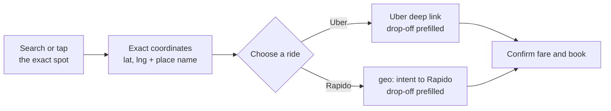

<div align="center">

# 📍 RideBridge

**Pin the exact spot on Google Maps. Book the ride there with Uber or Rapido.**

[](https://developer.uber.com/docs/deep-linking)
[](https://www.rapido.bike)
[](https://developers.google.com/maps)

[](https://react.dev)
[](https://vitejs.dev)
[](https://developers.google.com/maps/documentation/places/web-service/op-overview)

</div>

---

## The problem

Ride apps fill in your **pickup** from GPS, but the **destination** has to be typed. Search for a college, a hospital or a station and the app often lands on the main gate, the wrong road, or a nearby place with a similar name.

Google Maps usually *does* know the exact spot you mean. RideBridge carries that exact point straight into the ride app, so you never retype or re-search the destination.

## How it works



1. **Find the place**: search it, browse nearby categories, or tap anywhere on the map. Drag the pin to fine-tune (e.g. *Gate No. 2*, not the main gate).
2. **Check it**: the panel shows the place name, address, photos and exact coordinates.
3. **Book**: tap **Book with Uber** or **Book with Rapido**. The app opens with your current location as pickup and the pinned spot as drop-off.

## Features

| | Feature | Details |
|---|---|---|
| 🎯 | **Exact pin drop** | Tap anywhere or drag the pin; coordinates are passed, not a text search |
| 🔎 | **Place search** | Custom glass search box powered by Places API (New) autocomplete |
| 🏨 | **Nearby categories** | Restaurants, Cafes, Hotels, Things to do, Shopping, Hospitals within 2 km, with ratings and numbered markers |
| 🖼️ | **Place photos** | Up to 4 photos per place with a gallery and required author credit |
| 🛰️ | **Map / Satellite** | Switch to satellite view to see gates and buildings from above |
| 🚗 | **Uber** | Official universal deep link with drop-off latitude, longitude, name and address |
| 🏍️ | **Rapido** | Android `geo:` intent sent directly to the Rapido app |
| ✨ | **Glass UI** | Glassmorphism throughout, animated welcome screen, light and dark mode, reduced-motion support |
| 📱 | **Responsive** | Floating side panel on desktop, bottom sheet on phones |

## Tech stack

- **Frontend:** React 18 + Vite 5 (no backend, no database)
- **Maps:** Google Maps JavaScript API with Advanced Markers
- **Places:** Places API (New): Autocomplete, Place Details, Nearby Search, Place Photos
- **Ride hand-off:** Uber universal links and an Android intent URL for Rapido

## Getting started

### Prerequisites

- Node.js 18 or newer
- A Google Cloud project **with billing enabled** (Google Maps Platform requires it, even within the free usage tier)

### 1. Google Cloud setup

1. Open the [Google Cloud Console](https://console.cloud.google.com) and select or create a project.
2. Link a billing account to the project.
3. Under **APIs & Services → Library**, enable:
   - **Maps JavaScript API**
   - **Places API (New)**
4. Under **APIs & Services → Credentials**, create an **API key**.
5. Restrict the key: set **API restrictions** to the two APIs above, and add **website restrictions** for the domains you deploy to.


### 2. Test on your phone

Ride deep links only open the apps **on a phone**. On a desktop browser, Uber's link falls back to its website without the destination.

1. Connect your phone and computer to the **same Wi-Fi**.
2. Open the **Network** URL that Vite prints (e.g. `http://192.168.x.x:5173`) in your phone's browser.
3. Pick a place and tap **Book with Uber** or **Book with Rapido**.

> On macOS, if the phone can't reach the dev server, allow your terminal under **System Settings → Privacy & Security → Local Network**.

## How the ride links work

### Uber

Uses Uber's [documented universal deep link](https://developer.uber.com/docs/deep-linking):

```
https://m.uber.com/ul/?action=setPickup
  &pickup=my_location
  &dropoff[latitude]=<lat>
  &dropoff[longitude]=<lng>
  &dropoff[nickname]=<place name>
  &dropoff[formatted_address]=<address>
```

On a phone with Uber installed, the app opens with pickup set to the current location and the drop-off prefilled.

### Rapido

Rapido does not publish a deep link format. Its Android manifest registers the main activity for `geo:` URIs, so RideBridge sends a geo intent addressed to the Rapido package:

```
intent:<lat>,<lng>?q=<lat>,<lng>(<place name>)#Intent;scheme=geo;package=com.rapido.passenger;S.browser_fallback_url=<Play Store link>;end
```

- **Android:** Rapido opens with the destination prefilled. If Rapido isn't installed, the Play Store opens.
- **iOS and desktop:** the button copies the coordinates to the clipboard instead.

> ⚠️ This Rapido integration is **unofficial**. It relies on how the current Rapido Android app handles `geo:` links and may stop working after an app update.

## Project structure

```
RideBridge/
├── index.html
├── package.json
├── vite.config.js
├── .env                # your API key (git-ignored)
└── src/
    ├── main.jsx        # React entry
    ├── App.jsx         # map, search, categories, panel, welcome screen
    ├── maps.js         # loads the Google Maps JS API once
    ├── rideLinks.js    # builds the Uber and Rapido links
    └── styles.css      # glass design system and layout
```

## Configuration

| What | Where | Default |
|---|---|---|
| Search results region | `includedRegionCodes` in `App.jsx` | `['in']` (India only) |
| Nearby categories | `CATEGORIES` in `App.jsx` | 6 categories |
| Nearby search radius | `radius` in `showCategory` | `2000` metres |
| Results per category | `maxResultCount` | `10` |
| Starting map position | `DEFAULT_CENTER` | Bengaluru |
| Map ID | `mapId` | `DEMO_MAP_ID` (replace with your own for production) |

## API costs

Google Maps Platform bills per request. Each of these counts separately:

- Map loads
- Autocomplete requests while typing (debounced to reduce calls)
- Place Details when a place is selected
- Nearby Search on each category tap (includes ratings)
- Each photo loaded

New Google Cloud accounts usually get free trial credit. Set a **budget alert** under **Billing → Budgets & alerts** before sharing the app publicly.

## Security

- `.env` is git-ignored. **Never commit your API key.**
- A browser API key is always visible to users of the page, so protect it with **API restrictions** and **website (HTTP referrer) restrictions**.
- If a key has ever been exposed, **regenerate** it in the console.

## Known limitations

- Rapido works on **Android only**, and through an unofficial link.
- Ride apps may snap the drop-off to the nearest point they consider reachable.
- Deep links do not open apps from desktop browsers.
- Search results are limited to India by default.

## Roadmap

- [ ] Official Rapido integration (if Rapido offers a partner API)
- [ ] Ola support
- [ ] "Open in RideBridge" share target from the Google Maps app (Android)
- [ ] Fare comparison across apps
- [ ] Saved and recent places

## Disclaimer

RideBridge is an independent project and is **not affiliated with, endorsed by, or sponsored by** Uber, Rapido or Google. All product names, logos and trademarks belong to their respective owners.

---

<div align="center">

Built by **[Sumit Kumar Ranjan](https://github.com/sumitx99)**

</div>
